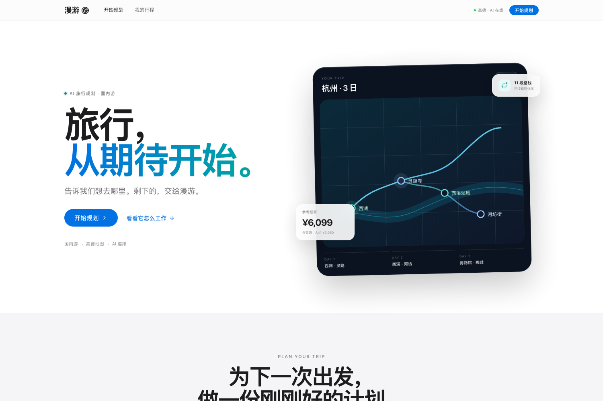
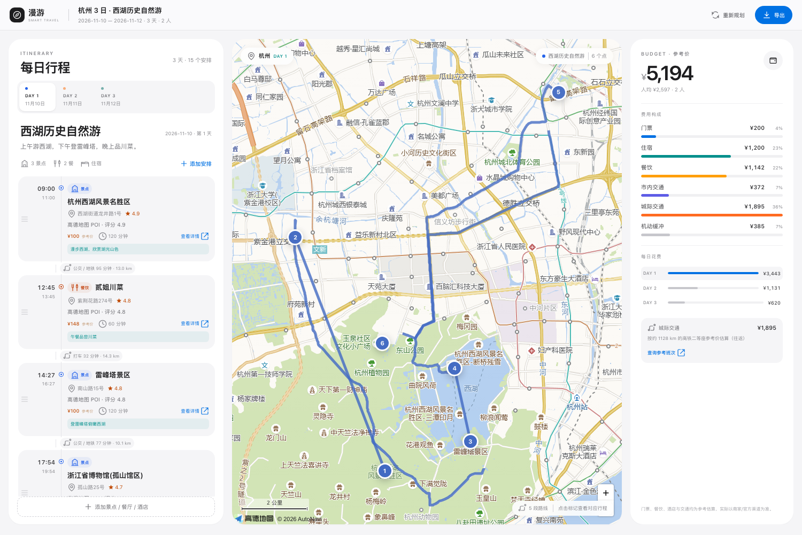

# 漫游 · 智能旅行助手

面向国内游的 AI 行程规划 Web 应用：输入目的地、日期、人数和偏好，自动生成包含景点、餐饮、酒店、交通的按天行程，并提供真实地图、预算明细、行程编辑和 PDF/长图导出。





## 功能

- AI + 规则双引擎行程规划，支持真实高德 POI
- 高德地图分日 Marker、路线、卡片联动
- 门票 / 住宿 / 餐饮 / 市内交通 / 城际交通预算明细
- 添加、删除、拖拽排序、锁定条目，实时重算路线与预算
- PDF / PNG 导出，Chrome 不可用时降级为可打印 HTML
- 匿名会话，无需登录

## 技术栈

`Vue 3 + TypeScript + Vite + Pinia` · `FastAPI + SQLAlchemy + SQLite/PostgreSQL` · `高德地图 JS API 2.0` · `OpenAI 兼容大模型` · `Jinja2 + Chrome Headless`

## 源码结构

```text
.
├── travel-assistant/          # 项目源码
│   ├── frontend/src/          # Vue 前端源码
│   ├── backend/app/           # FastAPI 后端源码
│   ├── backend/tests/         # 后端测试
│   ├── start.sh               # 启动脚本
│   ├── stop.sh
│   └── README.md              # 完整项目说明
└── docs/                      # 系统架构文档
    ├── architecture.md
    ├── architecture.html
    └── architecture.png
```

## 快速开始

```bash
cd travel-assistant
cp .env.example .env
# 在 .env 中填写高德与大模型 Key

python3 -m venv .venv
source .venv/bin/activate
pip install -r backend/requirements.txt

cd frontend
pnpm install
pnpm build
cd ..

./start.sh
```

打开 <http://127.0.0.1:8000>。

未配置 Key 时可以使用内置成都样例体验规则规划；配置后可规划任意国内城市并启用 AI 编排。

## 文档

- [完整项目说明](travel-assistant/README.md)
- [系统架构设计](docs/architecture.md)
- [架构图](docs/architecture.png)

## 安全说明

仓库不包含 `.env`、依赖目录、构建产物和本地数据库。请不要把填写了真实 Key 的 `.env` 上传到公开仓库。
