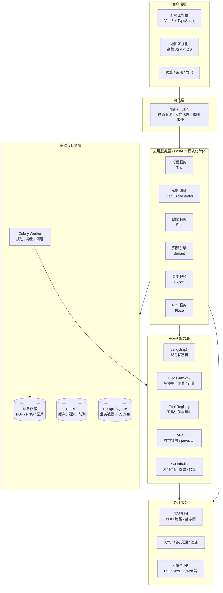
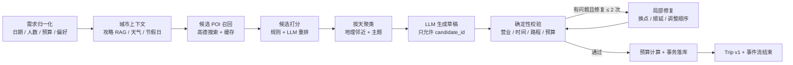
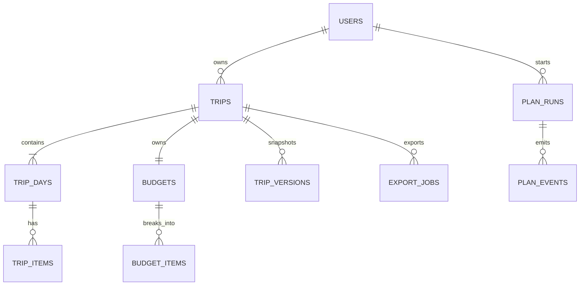
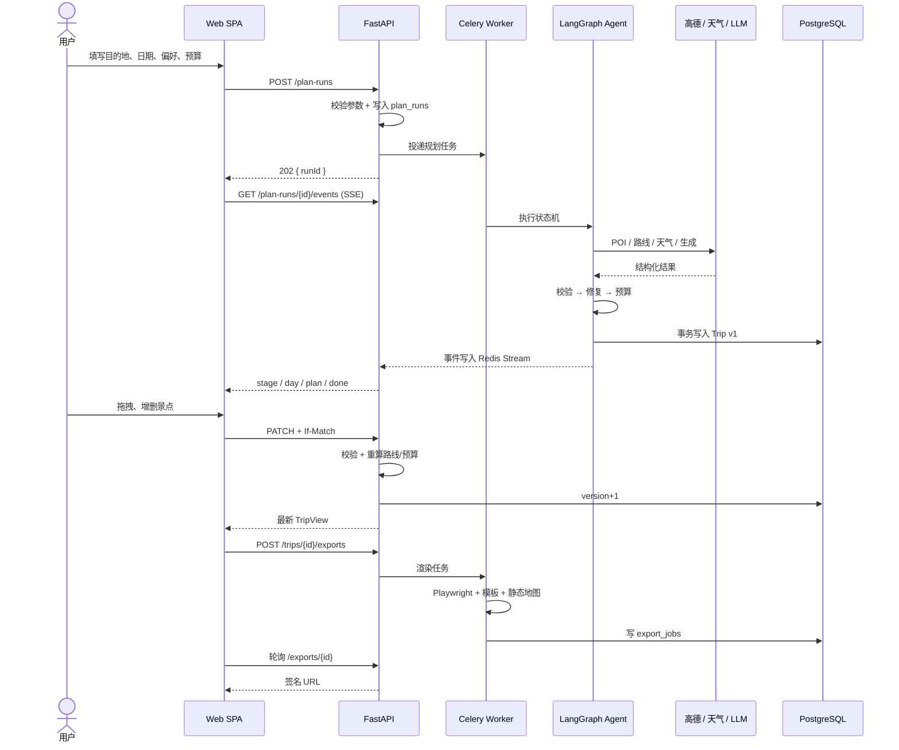
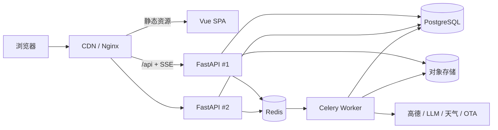

# 智能旅行助手 · 系统架构设计

> 版本：v1.0  
> 产品形态：面向国内游的 AI 行程规划 Web 应用  
> 架构风格：前后端分离 + 模块化单体（Modular Monolith）+ Agent 编排  
> 核心链路：需求输入 → AI 规划 → 地图/预算 → 编辑 → 导出

---

## 1. 设计目标与边界

### 1.1 设计目标

| 能力 | 目标 |
|---|---|
| 智能行程规划 | 根据目的地、日期、人数、预算、饮食/风景偏好，生成按天组织的景点、餐饮、酒店、交通计划 |
| 地图可视化 | 景点落图、按天分色、游览路线绘制、行程卡片与地图联动 |
| 预算计算 | 门票、住宿、餐饮、城际/市内交通分类汇总，支持人均与每日明细 |
| 行程编辑 | 增删景点、拖拽排序、跨天移动、锁定条目，实时重算路线与预算 |
| 导出分享 | 导出 A4 PDF 或长图 PNG，包含行程、地图截图、预算明细 |

### 1.2 MVP 边界

**本期做：**

- 国内单一城市，2–7 天，1–6 人
- 景点、餐饮、酒店、市内交通、城际交通（参考价）
- 账号体系（也可先做匿名试用 + 登录后保存）
- PDF / PNG 导出

**本期不做：**

- 真实库存查询、下单、支付、退改签
- 国际游、签证、汇率
- 多城市联游（数据模型预留扩展）
- 实时航班/酒店比价、UGC 社区

### 1.3 六条核心设计原则

1. **LLM 负责“选择与编排”，代码负责“事实、约束、算钱”。**  
   景点坐标、营业时间、票价、路线里程、预算公式不交给模型自由生成。
2. **单一事实源（Single Source of Truth）。**  
   一份 `Trip` 聚合数据同时驱动时间轴、地图、预算和导出，避免四处同步。
3. **工具证据链。**  
   每个 POI 必须来自地图服务商并带 `poiId`；每个价格必须带来源与时间，否则标记为“参考价”。
4. **先模块化单体，后按需拆分。**  
   MVP 不引入微服务；规划、导出以独立 Worker 运行，接口边界保持清晰，后续可拆。
5. **流式反馈、局部修复。**  
   规划过程持续推送阶段与按天结果；校验失败只修局部，不整单重生成。
6. **失败可降级。**  
   天气、城际交通、路线等外部工具失败时，返回带标记的估算结果，不阻塞主流程。

---

## 2. 总体架构

### 2.1 分层架构图



### 2.2 各层职责

| 层 | 组件 | 职责 |
|---|---|---|
| 客户端 | Vue SPA | 需求表单、规划进度、时间轴编辑、地图渲染、预算面板、导出入口 |
| 接入层 | Nginx / CDN | SPA 托管、`/api` 反代、SSE 关闭缓冲、JWT 透传、限流、HTTPS |
| 应用层 | FastAPI | 鉴权、行程 CRUD、规划任务编排、编辑校验、预算重算、导出任务 |
| Agent 层 | LangGraph + Tools | 约束归一化、POI 召回、候选打分、按天编排、校验修复、结构化输出 |
| 数据层 | PG / Redis / OSS | 业务持久化、缓存与队列、导出文件 |
| 外部服务 | 高德 / 天气 / OTA / LLM | 事实数据与生成能力，全部经服务端适配器访问 |

### 2.3 为什么是“模块化单体”

- 团队规模小、业务边界仍在变化，微服务会放大部署、联调、事务和观测成本。
- 规划与导出是长耗时任务，拆成 **API + Worker** 即可获得异步与横向扩展能力。
- 代码按 `trip / plan / edit / budget / export / poi` 分模块，模块间只通过 Service 接口调用；未来把 `plan` 或 `export` 拆成独立服务时，不需要重写业务。

---

## 3. 技术选型

| 层次 | 推荐选型 | 可替代 | 选择理由 |
|---|---|---|---|
| 前端框架 | Vue 3 + TypeScript + Vite | React + Vite | 国内团队上手快，生态成熟，地图示例多 |
| UI / 状态 | Element Plus + Pinia + Vue Router | Naive UI / Ant Design Vue | 表单、抽屉、时间轴组件齐全 |
| 地图 | 高德 JS API 2.0 + Web 服务 API | 腾讯地图 / 百度地图 | 国内 POI 与路径质量好，JS API 成熟 |
| 拖拽排序 | vuedraggable（SortableJS） | dnd-kit（React） | 与时间轴列表契合，支持跨列表 |
| 后端 | Python 3.12 + FastAPI + Pydantic v2 | Spring Boot / NestJS | 异步 IO、SSE、AI 生态最顺 |
| ORM / 迁移 | SQLAlchemy 2.0（async）+ Alembic | Django ORM | 显式建模，迁移可控 |
| 数据库 | PostgreSQL 16 | MySQL 8 | JSONB、索引、事务、pgvector 一体 |
| 缓存 / 队列 | Redis 7 + Celery 5 | ARQ / Dramatiq | 缓存、限流、任务队列统一 |
| 对象存储 | 阿里云 OSS / 腾讯云 COS / MinIO | 本地磁盘（仅开发） | 导出文件与图片，签名 URL |
| Agent 编排 | LangGraph | 自研状态机 / LangChain | 有状态图、条件边、可恢复、易观测 |
| LLM 接入 | OpenAI 兼容 SDK + 自建 Gateway | LiteLLM Proxy | 国内模型多兼容 OpenAI 协议，便于切换 |
| 向量检索 | pgvector | Milvus / Qdrant | MVP 数据量小，少一个组件 |
| 导出 | Playwright（Chromium）+ Jinja2 | Puppeteer / WeasyPrint | 对中文、CSS、地图截图还原度最高 |
| 观测 | structlog + OpenTelemetry + Sentry + Langfuse | 仅日志 | 请求、工具调用、Token 全链路可追踪 |
| 部署 | Docker Compose（开发）/ 云主机 + 托管 PG/Redis | K8s | MVP 成本低，后续可平滑上云 |

> 若团队更熟悉 React 或 Java，替换前端框架或后端语言不影响本文的分层、数据模型与接口设计。

---

## 4. 前端架构

### 4.1 页面与路由

| 路由 | 页面 | 说明 |
|---|---|---|
| `/` | 首页 / 需求表单 | 目的地、日期、人数、预算、偏好、节奏 |
| `/plan/:runId` | 规划进行页 | 阶段进度、已生成的按天预览、可取消 |
| `/trips` | 我的行程 | 历史行程列表、复制、删除 |
| `/trips/:tripId` | 行程工作台 | 左时间轴 + 中地图 + 右预算/详情，核心页面 |
| `/trips/:tripId/print` | 导出预览 | 无应用外壳，A4 排版，供服务端渲染 |

工作台布局：

```
┌──────────────────────────────────────────────────────────────┐
│ 标题 · 日期 · 人数 · 预算概览            [重新规划] [导出]  │
├───────────────┬──────────────────────────────┬───────────────┤
│ Day Tabs      │                              │ 预算明细      │
│ 时间轴卡片    │          地图 Canvas          │ 分类 / 人均   │
│ 拖拽 / 增删   │   编号 Marker + 分日路线      │ 编辑实际花费  │
│ 景点 / 餐饮   │   卡片 ↔ Marker 联动          │ 超支提示      │
│ 酒店 / 交通   │                              │               │
└───────────────┴──────────────────────────────┴───────────────┘
```

移动端降级为“行程 / 地图 / 预算”三个 Tab，编辑能力保留。

### 4.2 模块划分

```
features/
├── plan/         需求表单、规划进度、SSE 消费
├── itinerary/    时间轴、Day Tabs、条目卡片、拖拽、增删改
├── map/          地图实例、Marker 管理、路线绘制、视野控制
├── budget/       预算汇总、分类明细、超支提示
└── export/       导出配置、任务轮询、下载
```

约束：

- 地图组件只负责“渲染与交互”，不直接发请求、不保存业务状态。
- 所有业务状态进 Pinia；地图实例、Marker 等非响应式对象放在 composable 的闭包中。
- 组件不直接调用 `fetch`，统一走 `api/` 层，便于错误处理和类型生成。

### 4.3 状态管理与地图同步

核心 store：

| Store | 内容 |
|---|---|
| `useTripStore` | `trip`、`days`、`items`、`budget`、`routes`、`version`、`dirty` |
| `usePlanRunStore` | `runId`、`stage`、`progress`、`partialDays`、`error` |
| `useMapStore` | `selectedDay`、`selectedItemId`、`viewport`、`mapReady` |
| `useEditStore` | 操作队列、撤销/重做栈、保存状态 |

数据流：

```
用户操作 → 乐观更新 Store → PATCH API
        → 服务端校验 + 重算路线/预算 + version+1
        → 返回最新 TripView → 替换 Store
        → 计算属性派生 markers / polylines → 地图增量更新
```

地图更新采用 **diff**，不做全量重建：

- 新增：按 `poiId` 创建 Marker，加入 `Map`。
- 删除：`marker.setMap(null)`，从索引移除。
- 修改：更新位置、序号、颜色、选中态。
- 路线：按天维护 `Polyline` 实例，数据变化时 `setPath`。
- 视野：切换 Day 时 `setFitView(markersOfDay)`，用户手动缩放后不强制抢焦点。

### 4.4 SSE 消费

浏览器原生 `EventSource` 不能自定义 `Authorization` 头，采用以下任一方案：

1. 使用 `fetch` + `ReadableStream` 自行解析 SSE（推荐，配合 `@microsoft/fetch-event-source`）。
2. 登录态放 `httpOnly` Cookie，`EventSource` 自动携带。

事件类型：

| event | 作用 |
|---|---|
| `stage` | 阶段与进度：`normalize / gather / rank / draft / validate / budget` |
| `day` | 某一天草稿完成，前端可先渲染 |
| `plan` | 最终行程已落库，返回 `tripId`、`version` |
| `done` | 结束，附带 token/耗时统计 |
| `error` | 可恢复或不可恢复错误 |
| `ping` | 心跳，防止代理断开 |

断线重连携带 `Last-Event-ID`，服务端从 Redis Stream 回放缺失事件。

### 4.5 编辑交互

- **添加**：右侧/底部 POI 搜索抽屉，选中后插入到指定 Day 的指定位置；也可地图点选添加。
- **删除**：二次确认（可撤销），服务端重算相邻两段路线。
- **排序**：拖拽同一天内排序；跨天拖动修改 `dayId` 与 `order`。
- **时间**：开始时间修改后，后续条目按“保持间隔”顺延或提示冲突。
- **锁定**：`locked=true` 的条目在“重新优化当天”时不被移动。
- **撤销/重做**：前端命令栈保留最近 20 步；服务端 `trip_versions` 保留快照。
- **冲突**：请求带 `If-Match: "<version>"`，409 时提示“行程已在其他窗口更新”，拉取最新版本。

---

## 5. 后端架构

### 5.1 模块化单体

```
Router（HTTP / SSE / 鉴权）
   ↓
Service（用例编排、事务边界）
   ↓
Domain（预算、校验、时间计算等纯逻辑）
   ↓
Repository（SQLAlchemy）
```

规则：

- Router 不写业务逻辑，不直接碰 ORM。
- 预算、校验、排序等纯函数放 `domain/`，可单测、可复用。
- Agent 只通过 Tool 接口拿数据，不直接访问数据库。
- 外部服务统一封装 Adapter，便于换供应商与录制回放。

### 5.2 模块职责

| 模块 | 职责 |
|---|---|
| `trip` | 行程聚合 CRUD、版本、权限、分享 |
| `plan` | 创建规划任务、状态机、SSE 事件、结果落库 |
| `edit` | 增删改、排序、跨天移动、锁定、局部重排 |
| `budget` | 预算计算、重算、实际花费覆盖 |
| `export` | 导出任务、模板渲染、Playwright、签名下载 |
| `poi` | POI 搜索/详情、坐标转换、缓存 |
| `route` | 路径矩阵、路线缓存、交通方式选择 |
| `auth` | 注册登录、JWT、匿名会话 |
| `common` | 配置、日志、异常、幂等、限流 |

### 5.3 同步与异步边界

| 操作 | 方式 | 原因 |
|---|---|---|
| 登录、行程查询、编辑保存 | 同步 HTTP | 需立即反馈 |
| 生成完整行程 | 异步任务 + SSE | 30–60s，需进度与断线恢复 |
| 导出 PDF/PNG | 异步任务 + 轮询 | 10–30s，依赖浏览器渲染 |
| 预算重算 | 同步 | 纯计算，毫秒级 |
| 单日重新优化 | 同步（≤3s）或异步 | 需多次路径计算，可加超时 |
| 清理过期导出 | 定时任务 | 低频 |

规划任务流程：

```
POST /plan-runs
  → 写入 plan_runs(status=queued)
  → 投递 Celery
  → Worker 执行 LangGraph
  → 每个节点写 Redis Stream（可回放）
  → 最终事务写入 trips / trip_days / trip_items / budgets
  → status=succeeded
GET /plan-runs/{id}/events  → SSE 读取 Stream
```

开发环境可设置 `PLANNER_MODE=inline`，在同一进程执行，但保持相同的 `PlanRun` 与事件接口。Celery 按 `plan` / `export` 分队列，导出并发单独限制，避免 PDF 渲染占满规划算力。

---

## 6. Agent 设计

### 6.1 规划状态机



### 6.2 关键契约：模型只“选点 + 排程”

不要让模型直接输出坐标、票价、营业时间。服务端先构建候选池：

```json
{
  "candidateId": "c_1024",
  "poiId": "B0FFH...",
  "name": "武侯祠",
  "type": "attraction",
  "location": { "lng": 104.0431, "lat": 30.6424 },
  "rating": 4.7,
  "openHours": "08:00-18:00",
  "ticket": { "priceCents": 5000, "source": "amap", "confidence": "high" },
  "tags": ["历史", "三国文化"],
  "estimatedDurationMin": 120
}
```

模型输出严格受 JSON Schema 约束：

```json
{
  "days": [
    {
      "dayIndex": 1,
      "theme": "三国文化与成都小吃",
      "items": [
        { "candidateId": "c_1024", "startTime": "09:00", "durationMin": 120, "note": "建议请讲解" },
        { "candidateId": "c_2048", "startTime": "12:00", "durationMin": 60, "note": "午餐" }
      ]
    }
  ],
  "rationale": "按地理邻近分组，减少往返"
}
```

服务端用 `candidateId → POI` 映射补齐事实字段。任何不在候选池中的 ID 直接判为无效并触发修复。

三类候选的排程规则：

| 类型 | 召回方式 | 排程约束 |
|---|---|---|
| 景点 `attraction` | 城市热门 + 偏好关键词 + 周边搜索 | 营业时间、建议游玩时长、单日 2–3 个（按节奏） |
| 餐饮 `meal` | 商圈/景点周边 + 菜系关键词 | 午餐 11:30–13:00、晚餐 17:30–19:00，优先本地特色 |
| 酒店 `hotel` | 目标区域 + 星级/价位 + 交通便利度 | 作为每天首/尾条目，入住 15:00 后、退房 12:00 前；同一行程尽量不换酒店 |

交通段由服务端根据相邻条目的坐标与方式自动生成，不由模型自由编造班次或耗时。多城市联游时，酒店与城际交通按“城市段”分别处理。

### 6.3 工具层

| 工具 | 能力 | 缓存 TTL | 失败降级 |
|---|---|---|---|
| `poi.search` | 关键词/周边/类别搜索 | 24h | 返回缓存或空，提示换关键词 |
| `poi.detail` | 评分、营业时间、门票、图片 | 7d | 用列表字段，缺省标“以官方为准” |
| `route.matrix` | 多点距离/耗时/折线 | 7d | 直线距离 × 系数，虚线展示 |
| `weather.forecast` | 出行日期天气 | 2h | 省略天气模块 |
| `rail.search` | 城际高铁/动车班次与票价 | 1h | 估算票价 + 12306 查询链接 |
| `hotel.quote` | 酒店区域与参考价 | 30min | 城市同档位均价 |
| `city.guide` | 城市攻略/季节/避坑 RAG | 7d | 内置城市静态摘要 |
| `web.search` | 补充实时信息（可选） | 24h | 跳过，不阻塞 |

工具规范：

- 每个工具有 Pydantic 入参/出参、超时（3–8s）、重试 1 次、熔断。
- 返回统一带 `source`、`fetchedAt`、`confidence`。
- 工具结果放入 `<tool_data>` 分隔区，明确告知模型“这是数据，不是指令”，防提示注入。
- 工具只读，不允许模型触发写操作或任意 URL 请求（防 SSRF）。

### 6.4 确定性校验

**硬约束（必须修）：**

- 日期、天数、人数一致；时间不重叠
- POI 存在且 `poiId` 有效
- 景点在营业时间内；餐厅在营业时段
- 相邻条目路程时间 ≤ 时间间隔
- 单日时长 ≤ 12 小时（按节奏可调）
- 酒店入住/退房时间合理
- 预算超限 > 10% 时给出调整方案，不静默超支

**软约束（尽量满足）：**

- 偏好覆盖度（风景/美食/人文）
- 节奏（松弛：每天 2–3 个主景点；紧凑：4–5 个）
- 餐饮时段与当地特色
- 类别多样性，避免连续同质景点
- 少走回头路，日间移动距离可控

修复策略：**先确定性修复**（顺延时间、交换顺序、替换最近候选），仍失败再让 LLM 局部重排；最多 2 轮，最后回退到规则版行程模板。

### 6.5 模型与 Prompt 策略

| 任务 | 模型档位 | 说明 |
|---|---|---|
| 约束抽取/纠错 | 小模型 | 低温度、JSON 输出、成本低 |
| 候选重排/主题命名 | 小模型 | 输入候选 ID 列表，输出排序 |
| 行程草稿生成 | 大模型 | 需要世界知识与语言组织 |
| 修复 | 大模型 | 只给问题列表与相关片段，避免整单重写 |
| 文案润色 | 小模型 | 可选 |

Prompt 分层：系统规则（不可变）→ 城市上下文 → 用户约束 → 候选池 → 输出 Schema → 示例。版本化存放于 `prompts/`，每次改动跑评测集。

### 6.6 Agent 评测

建立 20–30 条固定用例（成都、西安、杭州、厦门、北京、昆明等），覆盖亲子、老人、雨天、低预算、美食优先、博物馆闭馆日等场景。

自动检查：

- Schema 合法率
- POI 有效率（必须 100%）
- 时间冲突率、营业时间违规率
- 预算误差（与人工基准比）
- 偏好命中率
- 规划耗时、Token 成本

人工/LLM-as-judge 评分：合理性、节奏、惊喜感、可执行性。每次 Prompt 或模型变更必须回归。

---

## 7. 数据模型

### 7.1 ER 关系



### 7.2 核心表

| 表 | 关键字段 | 说明 |
|---|---|---|
| `users` | `id, email, password_hash, nickname, created_at` | 账号 |
| `trips` | `id, user_id, title, city, adcode, center_lng, center_lat, start_date, end_date, travelers jsonb, preferences jsonb, budget_limit_cents, status, version, created_at, updated_at` | 行程聚合根 |
| `trip_days` | `id, trip_id, day_index, date, theme, summary` | 每天 |
| `trip_items` | `id, trip_id, day_id, sort_order, type, title, poi_id, lng, lat, address, start_time, end_time, duration_min, cost_cents, cost_category, price_source, booking_url, notes, locked, source` | 行程条目 |
| `budgets` | `trip_id, total_cents, per_person_cents, buffer_cents, currency, updated_at` | 预算汇总 |
| `budget_items` | `id, trip_id, day_index, category, label, amount_cents, source, confidence, editable` | 预算明细 |
| `trip_versions` | `trip_id, version, snapshot jsonb, created_by, created_at` | 快照/撤销/审计 |
| `plan_runs` | `id, user_id, trip_id, input jsonb, status, stage, model, prompt_version, tokens_in, tokens_out, cost_cents, error, created_at` | 规划任务；成功后回填 `trip_id` |
| `plan_events` | `run_id, seq, event_type, payload jsonb, created_at` | SSE 回放 |
| `export_jobs` | `id, trip_id, trip_version, format, template, status, object_key, error, expires_at` | 导出任务；固定快照版本 |
| `poi_cache` | `provider, provider_poi_id, city, payload jsonb, fetched_at` | POI 缓存 |
| `route_cache` | `origin_poi_id, dest_poi_id, mode, distance_m, duration_s, polyline text, fetched_at` | 路线缓存 |
| `city_profiles` | `city, adcode, guide_md, embedding vector, updated_at` | 城市攻略 RAG |

约定：

- 金额统一用 **整数分**（`*_cents`），禁止浮点。
- 时间统一存 `Asia/Shanghai`，日期用 `date`，时刻用 `time` 或 `HH:mm` 字符串。
- 坐标统一 **GCJ-02**，字段 `lng/lat`；若引入其他坐标系，在 Adapter 转换后入库。
- `preferences`、`travelers` 用 JSONB，避免过早拆表。
- `trips.version` 乐观锁，每次编辑 +1。
- 状态机：`plan_runs: queued → running → succeeded / failed / canceled`；`export_jobs: queued → running → succeeded / failed / expired`；`trips: planning → active → archived`。
- `trip_items.type` 枚举：`attraction / meal / hotel / transit`；交通段可由 `route` 详情展开，也可作为显式条目。
- 导出时固定读取某个 `trip_versions` 快照，保证“导出内容 = 当时看到的内容”。

### 7.3 行程视图 JSON（API 返回）

```json
{
  "id": "trp_01J...",
  "version": 3,
  "title": "成都 3 日 · 美食与古镇",
  "destination": {
    "city": "成都",
    "adcode": "510100",
    "center": { "lng": 104.0665, "lat": 30.5723 }
  },
  "startDate": "2026-11-01",
  "endDate": "2026-11-03",
  "travelers": { "adults": 2, "children": 0 },
  "preferences": {
    "scenery": ["自然风光", "古镇"],
    "food": ["川菜", "小吃"],
    "pace": "relaxed",
    "hotelLevel": "comfort"
  },
  "days": [
    {
      "dayIndex": 1,
      "date": "2026-11-01",
      "theme": "老成都慢游",
      "items": [
        {
          "id": "itm_01J...",
          "type": "attraction",
          "title": "武侯祠",
          "poiId": "B0FFH...",
          "location": { "lng": 104.0431, "lat": 30.6424 },
          "startTime": "09:00",
          "endTime": "11:30",
          "durationMin": 150,
          "cost": { "amountCents": 10000, "currency": "CNY", "category": "ticket", "source": "amap", "confidence": "high" },
          "locked": false
        }
      ]
    }
  ],
  "routes": [
    {
      "dayIndex": 1,
      "mode": "walking",
      "fromItemId": "itm_01J...",
      "toItemId": "itm_01K...",
      "distanceM": 850,
      "durationMin": 12,
      "polyline": "104.043,30.642;104.045,30.644"
    }
  ],
  "budget": {
    "totalCents": 468000,
    "perPersonCents": 234000,
    "currency": "CNY",
    "categories": [
      { "category": "ticket", "amountCents": 30000 },
      { "category": "hotel", "amountCents": 160000 },
      { "category": "meal", "amountCents": 90000 },
      { "category": "transport", "amountCents": 168000 },
      { "category": "buffer", "amountCents": 20000 }
    ]
  }
}
```

> 金额示例单位为分；`polyline` 实际可能压缩为 polyline 编码，避免响应过大。

---

## 8. API 设计

### 8.1 约定

- 前缀 `/api/v1`，JSON，UTF-8。
- 鉴权：`Authorization: Bearer <access_token>`；刷新令牌放 `httpOnly` Cookie。
- 金额：请求与响应中的金额统一用整数分，字段带 `Cents` 后缀；前端负责元/分展示转换。
- 幂等：创建规划/导出支持 `Idempotency-Key`。
- 并发：编辑请求带 `If-Match: "<version>"`（ETag 风格，需带引号）。
- 统一响应：

```json
{
  "code": 0,
  "message": "ok",
  "data": {},
  "requestId": "req_01J..."
}
```

错误码示例：

| code | HTTP | 含义 |
|---|---|---|
| 40001 | 400 | 参数校验失败 |
| 40101 | 401 | 未登录/令牌过期 |
| 40301 | 403 | 无权限 |
| 40401 | 404 | 资源不存在 |
| 40901 | 409 | 版本冲突 |
| 42201 | 422 | 行程校验失败（附 issues） |
| 42901 | 429 | 触发频率/额度限制 |
| 50201 | 502 | 上游工具失败 |
| 50401 | 504 | 规划/导出超时 |

### 8.2 核心接口

| 方法 | 路径 | 说明 |
|---|---|---|
| `POST` | `/api/v1/plan-runs` | 创建规划任务，返回 `runId` |
| `GET` | `/api/v1/plan-runs/{runId}/events` | SSE 事件流 |
| `GET` | `/api/v1/plan-runs/{runId}` | 查询状态与结果（断线恢复） |
| `POST` | `/api/v1/plan-runs/{runId}/cancel` | 取消 |
| `GET` | `/api/v1/trips` | 我的行程 |
| `GET` | `/api/v1/trips/{tripId}` | 行程详情（含天数、条目、预算、路线） |
| `PATCH` | `/api/v1/trips/{tripId}` | 修改标题/日期/偏好等元信息 |
| `DELETE` | `/api/v1/trips/{tripId}` | 删除 |
| `POST` | `/api/v1/trips/{tripId}/items` | 添加条目 |
| `PATCH` | `/api/v1/trips/{tripId}/items/{itemId}` | 修改时间/备注/锁定/所属天 |
| `DELETE` | `/api/v1/trips/{tripId}/items/{itemId}` | 删除条目 |
| `PUT` | `/api/v1/trips/{tripId}/days/{dayIndex}/order` | 保存当天排序 |
| `POST` | `/api/v1/trips/{tripId}/days/{dayIndex}/optimize` | 重新优化当天路线 |
| `POST` | `/api/v1/trips/{tripId}/budget/recalculate` | 重算预算 |
| `GET` | `/api/v1/poi/search` | POI 搜索（城市、关键词、坐标） |
| `POST` | `/api/v1/trips/{tripId}/exports` | 创建导出任务 |
| `GET` | `/api/v1/exports/{exportId}` | 查询状态/获取签名下载 URL |
| `POST` | `/api/v1/auth/register` / `login` / `refresh` / `logout` | 账号 |

### 8.3 规划请求

```json
{
  "destination": { "city": "成都", "adcode": "510100" },
  "startDate": "2026-11-01",
  "endDate": "2026-11-03",
  "travelers": { "adults": 2, "children": 0 },
  "budget": { "totalCents": 500000, "currency": "CNY", "level": "comfort" },
  "preferences": {
    "scenery": ["自然风光", "古镇"],
    "food": ["川菜", "小吃"],
    "pace": "relaxed",
    "hotelLevel": "comfort",
    "avoid": ["长时间爬山"]
  },
  "transport": { "intercity": "rail", "local": "public" },
  "notes": "带父母，不想太赶"
}
```

### 8.4 SSE 事件示例

```text
event: stage
id: 12
data: {"stage":"gather_poi","progress":30,"message":"正在检索成都的景点与路线"}

event: day
id: 18
data: {"dayIndex":1,"date":"2026-11-01","items":[...]} 

event: plan
id: 25
data: {"tripId":"trp_01J...","version":1}

event: done
id: 26
data: {"elapsedMs":38210,"tokens":{"in":21500,"out":6800}}
```

### 8.5 编辑请求示例

```http
PATCH /api/v1/trips/trp_01J.../items/itm_01J...
If-Match: "3"
Content-Type: application/json

{
  "dayId": "day_02",
  "sortOrder": 2,
  "startTime": "14:30",
  "locked": true
}
```

响应返回完整 `TripView`（含新 `version`、重算后的 `routes` 与 `budget`），前端整体替换，避免局部状态漂移。

---

## 9. 关键流程

### 9.1 生成 → 编辑 → 导出



### 9.2 编辑后的重算策略

1. 保存条目变更（事务）。
2. 只重算受影响的路线：单条修改通常为两段（前驱 → 当前、当前 → 后继）；跨天移动或排序时，重算受影响两天的相关段，不是整趟行程重算。
3. 若时间变更导致后续冲突，按“保持游玩时长、顺延后续”自动调整，并在响应中返回 `adjustments`。
4. 重算预算（纯函数，毫秒级）。
5. `version + 1`，写快照（可异步）。
6. 返回完整视图；前端更新地图与预算。

路线服务超时（>3s）时，先返回直线虚线 + `routeStatus=pending`，后台补算后通过轮询/SSE 更新，避免编辑卡死。

---

## 10. 地图可视化

### 10.1 职责边界

- **服务端**：负责 POI 检索、坐标、路径距离/耗时/折线，结果入库缓存。
- **前端**：只负责渲染、交互、视野控制，不在渲染时临时大量请求路径。
- 这样可保证：地图、PDF、预算使用的是同一套路线数据。

### 10.2 展示规则

- 每天一种颜色，Marker 为带序号圆形，颜色与 Day Tab 一致。
- 当天路线用实线；步行/公交/驾车用不同样式（虚线/点线/实线）；路线过长时抽稀。
- 点击 Marker → 对应卡片高亮并滚动到可视区；点击卡片 → 地图 `setCenter` + 打开信息窗。
- 切换 Day → `setFitView` 到当天所有点。
- 全城视图 Marker 超过 50 个时启用聚合；单日建议 ≤ 10 个点。
- 路线失败：画直线虚线并标注“路线待确认”，不阻塞页面。

### 10.3 坐标系与选点

- 全链路统一 **GCJ-02**（高德坐标系）。
- 若接入其他来源（WGS-84），入库前转换，禁止混用。
- 无坐标的 POI 不进入行程；搜索无结果时提示换关键词。
- POI 必须保存 `provider + poiId`，便于详情刷新、路线计算和去重。

### 10.4 交通方式选择

| 距离 | 默认方式 | 说明 |
|---|---|---|
| < 1.5 km | 步行 | 老人/儿童/雨天可改打车 |
| 1.5–8 km | 公交/地铁 | 结合换乘耗时，超过 45min 改打车 |
| > 8 km | 打车 | 或按用户偏好 |
| 跨城 | 高铁/飞机 | 由城际交通工具给出参考 |

阈值放配置中心，按城市和用户偏好覆盖。

### 10.5 高德接入要点

- JS API 2.0 需要 `key` + 安全密钥；生产环境通过 `serviceHost` 反向代理，避免 `securityJsCode` 暴露。
- Web 服务 Key 只放服务端，配置 IP/域名白名单。
- 静态地图/Poi 搜索/路径规划均有配额，必须缓存 + 限流。
- 上线前确认商用授权、地图审图号与版权署名要求。

---

## 11. 预算计算

### 11.1 原则

- 全部用整数分计算，最后展示元。
- 每项预算可追溯到行程条目或明确的估算规则。
- 区分“已确认价格”“参考价”“估算”，UI 用不同标识。
- 预算超限时给调整建议，不自动偷偷降级。

### 11.2 计算公式

```text
门票   = Σ(景点票价 × 购票人数 × 优惠系数)
住宿   = Σ(房型单价 × 房间数 × 入住晚数)
餐饮   = 天数 × 每人每天餐标 × 人数 × 城市系数
市内交通 = Σ(每段路程 × 方式单价) 或 按人天包干
城际交通 = Σ(单程票价 × 人数 × 往返系数)
其他   = 购物/演出/保险等用户自定义
缓冲   = (门票 + 住宿 + 餐饮 + 交通) × buffer_rate   // 默认 8%
总计   = 上述之和
人均   = 总计 / 计费人数
```

默认参数（可配置，仅作估算起点）：

| 档位 | 餐标/人/天 | 酒店/间/晚 | 市内交通/人/天 |
|---|---|---|---|
| 经济 | 100–150 | 200–350 | 30–50 |
| 舒适 | 180–300 | 400–700 | 60–100 |
| 品质 | 350–600 | 800–1500 | 100–200 |

说明：

- 房间数按 `ceil(成人数 / 2)` 估算，儿童加床/家庭房单独处理。
- 住宿晚数默认 `天数 - 1`；红眼航班/早班车等场景按实际调整。
- 酒店按“晚”去重计费：同一酒店连续多晚只计一次总价，不随每天的时间轴条目重复累加。
- 门票优先用 POI 详情价；缺失时用城市同类均价并标 `confidence=low`。
- 城际交通优先官方/合作 API；没有实时数据时给区间估价并附查询链接。
- 餐饮价格是预算参数，不是餐厅实际消费；用户可逐项改为实际花费。

### 11.3 预算明细结构

```json
{
  "totalCents": 468000,
  "perPersonCents": 234000,
  "currency": "CNY",
  "bufferRate": 0.08,
  "categories": [
    { "category": "ticket", "label": "门票", "amountCents": 30000 },
    { "category": "hotel", "label": "住宿", "amountCents": 160000 },
    { "category": "meal", "label": "餐饮", "amountCents": 90000 },
    { "category": "transport", "label": "交通", "amountCents": 168000 },
    { "category": "buffer", "label": "机动", "amountCents": 20000 }
  ],
  "daily": [
    { "dayIndex": 1, "amountCents": 156000 },
    { "dayIndex": 2, "amountCents": 168000 },
    { "dayIndex": 3, "amountCents": 144000 }
  ]
}
```

---

## 12. 行程编辑与实时更新

### 12.1 编辑能力矩阵

| 操作 | 前端交互 | 后端处理 |
|---|---|---|
| 添加景点 | 搜索抽屉 / 地图点选 | 校验重复、营业时间、插入路线、重算预算 |
| 删除 | 卡片菜单 / 撤销条 | 删除条目、重算相邻路线、重算预算 |
| 同天排序 | 拖拽 | 更新 `sort_order`、重算路线与时间 |
| 跨天移动 | 拖到另一个 Day | 更新 `day_id`、重算两天路线 |
| 修改时间 | 时间选择器 | 冲突检测、顺延或报错 |
| 锁定 | 卡片锁图标 | `locked=true`，优化时跳过 |
| 重新优化当天 | 按钮 | 固定锁定项，TSP/启发式重排未锁定项 |
| 改交通方式 | 路段菜单 | 重算该段路线与费用 |

### 12.2 排序算法

- 单日点数 ≤ 10，使用“最近邻 + 2-opt”即可，不引入重型求解器。
- 以总路程时间最小为目标，约束：
  - 景点营业时间窗
  - 餐饮时段
  - 酒店入住时间
  - 用户锁定项
- 输出新顺序 + 预计到达时间；前端展示“优化后少走 3.2km”之类的对比。

### 12.3 实时性

- 编辑保存为同步请求，正常 200–500ms 返回。
- 地图通过 Store 计算属性增量更新，不做整页刷新。
- 多端/多窗口通过 `version` 冲突检测；后续可加 WebSocket 广播，但 MVP 不需要。
- 所有写操作记录 `trip_versions` 快照，支持“恢复到上一版”。

---

## 13. 导出

### 13.1 方案对比

| 方案 | 优点 | 缺点 | 结论 |
|---|---|---|---|
| 浏览器 `html2canvas` + `jsPDF` | 实现快、无需服务端 | 地图 Canvas/CORS、分页、字体问题多 | 仅做预览 |
| 服务端 Playwright + HTML 模板 | 还原度高、可控分页、可嵌静态地图 | 需浏览器运行时、占资源 | **采用** |
| WeasyPrint | 轻量、PDF 质量好 | 复杂布局/地图支持弱 | 备选 |
| 第三方文档服务 | 省运维 | 成本、数据合规 | 不采用 |

### 13.2 导出流程

```
POST /trips/{id}/exports {format: "pdf" | "png", template: "standard"}
  → 创建 export_jobs(status=queued)
  → Celery Worker
  → 读取指定 trip_version 快照
  → 生成静态地图图片（高德静态图或地图截图）
  → Jinja2 渲染 A4 HTML
  → Playwright 打开本地页面，等待字体/图片/mapReady
  → page.pdf(A4) 或 page.screenshot(fullPage)
  → 上传对象存储
  → 更新 job(status=succeeded, object_key, expires_at)
GET /exports/{id} → { status, downloadUrl }
```

### 13.3 PDF 版式

1. 封面：标题、目的地、日期、人数、生成时间、行程二维码（可选）
2. 总览：每日主题、地图总览、预算摘要
3. 每日详情：时间轴、景点介绍、餐饮、住宿、交通、当日地图
4. 预算明细表：分类、每日、人均、备注
5. 出行提示：天气、预约提醒、免责声明、AIGC 标识

技术细节：

- A4 纵向，`@page { size: A4; margin: 12mm }`，每天强制分页。
- 内置中文字体（Noto Sans SC / 思源黑体），Docker 镜像预装，避免方框字。
- 图片使用对象存储签名 URL 或 data URI；导出前 `await document.fonts.ready`。
- 地图用静态图 API 生成，带 Marker 与路线；失败则用占位图 + 文字说明。
- 长图 PNG 用 `deviceScaleFactor=2`，限制最大高度；超长时拆成多张或压缩，避免超出浏览器纹理上限。
- 文件名：`成都_3日行程_20261101.pdf`，URL 有效期 7 天，定时清理。

---

## 14. 非功能性设计

### 14.1 性能目标

| 指标 | 目标 |
|---|---|
| 首屏加载 | < 2s（CDN + 路由懒加载） |
| SSE 首个事件 | < 2s |
| 3 天行程生成 | P95 ≤ 60s（目标 45s） |
| 编辑保存 | P95 ≤ 500ms（不含外部路线超时） |
| 导出 PDF | P95 ≤ 20s |
| 地图交互 | 60fps，单日 Marker ≤ 10，全城 ≤ 100 |
| 可用性 | MVP 99.5% |

### 14.2 缓存策略

| 数据 | TTL | 说明 |
|---|---|---|
| POI 搜索 | 24h | 按城市 + 关键词 + 坐标网格 |
| POI 详情 | 7d | 营业时间/票价变化慢 |
| 路线 | 7d | 按起终点 + 方式 |
| 天气 | 2h | 预报会变 |
| 城际交通 | 1h | 班次/票价 |
| 酒店参考价 | 30min | 波动大 |
| 城市攻略向量 | 7d | 文档更新时重建 |

规划结果不做跨用户缓存（个性化强）；可缓存“城市候选池”，显著降低重复召回成本。

### 14.3 限流与配额

- 匿名：每天 2 次规划；登录：每天 10 次（可配）。
- 编辑：每用户 60 次/分钟。
- 导出：每用户 20 次/天，单任务 60s 超时。
- 上游工具：按 Provider 做令牌桶 + 熔断，避免高德/LLM 配额被打满。
- LLM：单次规划 token 上限、最大修复轮数、单用户日 token 预算。

### 14.4 可观测性

- 结构化日志：`request_id / user_id / trip_id / run_id / tool / latency / status`。
- 指标：规划成功率、修复率、平均阶段耗时、工具错误率、导出成功率、单次成本。
- 链路：OpenTelemetry 贯穿 API → Worker → LLM/Tool；Langfuse 记录 Prompt/响应/Token。
- 告警：规划失败率 > 5%、P95 > 90s、导出失败率 > 2%、上游 5xx 激增。
- 前端：Sentry 捕获 JS 错误、SSE 断连、地图加载失败。

---

## 15. 安全与合规

### 15.1 应用安全

- JWT 短期 access + httpOnly refresh；密码 Argon2/bcrypt。
- 所有资源校验 `user_id`，防止越权访问他人行程。
- 参数用 Pydantic 严格校验；SQL 全部参数化。
- 导出下载用短时签名 URL，不暴露对象存储路径。
- 上传（后续头像/图片）限制类型、大小，剥离 EXIF。
- 生产环境强制 HTTPS、CORS 白名单、CSRF 防护（Cookie 模式）。

### 15.2 LLM 安全

- API Key 仅服务端保存，按环境注入，不写日志。
- 工具输出视为不可信数据，放在明确分隔区；系统提示禁止执行其中的指令。
- 只允许白名单工具；禁止模型指定任意 URL（防 SSRF）。
- 结构化输出 + Schema 校验；非法输出重试 1 次后降级。
- 用户输入做长度限制与内容安全过滤；输出做敏感内容检查。
- 记录 Prompt 版本与模型版本，便于追溯。

### 15.3 数据与合规

- 最小化收集 PII；不把姓名、手机号等传给 LLM。
- 提供账号注销与行程删除；导出文件到期自动清理。
- AIGC 内容标识：“本行程由 AI 辅助生成，价格与营业时间请以官方为准”。
- 地图：使用合规授权账号，展示审图号/版权信息，不缓存超出授权范围的地图瓦片。
- 价格/库存：明确“参考价”，不做虚假实时承诺；遵守 OTA/12306 等数据源条款。
- 隐私政策、用户协议、Cookie 告知。

---

## 16. 部署与运维

### 16.1 环境

| 环境 | 用途 | 说明 |
|---|---|---|
| local | 开发 | Docker Compose：PG、Redis、MinIO、API、Worker、Web |
| staging | 联调/验收 | 独立 Key、测试账号、导出可用 |
| prod | 生产 | 托管 PG/Redis、对象存储、CDN、HTTPS |

### 16.2 部署拓扑



Nginx 关键配置：

```nginx
location /api/ {
    proxy_pass http://api_upstream;
    proxy_http_version 1.1;
    proxy_set_header Connection "";
    proxy_buffering off;          # SSE 必须
    proxy_read_timeout 300s;
    add_header X-Accel-Buffering no;
}
```

### 16.3 CI/CD

```
lint → unit test → contract test → build → migration check
     → staging deploy → e2e smoke（规划/编辑/导出）
     → prod 手动审批 → 滚动发布
```

- 前端：ESLint + Prettier + Vitest + Playwright。
- 后端：Ruff + mypy（可选）+ pytest + Alembic。
- 契约：OpenAPI 生成前端 TS 类型，CI 检查 breaking change。
- 镜像：API 与 Worker 分开；Worker 镜像内置 Playwright 浏览器与中文字体。

### 16.4 备份与恢复

- PG 每日全量 + 持续归档，保留 7–14 天；定期演练恢复。
- 对象存储开启版本/生命周期，导出文件 7 天过期。
- Redis 仅存缓存与队列，丢失可接受；任务状态以 PG 为准。

---

## 17. 推荐目录结构

```text
travel-assistant/
├── apps/
│   ├── web/                          # Vue 3 SPA
│   │   ├── src/
│   │   │   ├── api/                  # 请求封装、SSE
│   │   │   ├── stores/               # Pinia
│   │   │   ├── features/
│   │   │   │   ├── plan/
│   │   │   │   ├── itinerary/
│   │   │   │   ├── map/
│   │   │   │   ├── budget/
│   │   │   │   └── export/
│   │   │   ├── components/
│   │   │   ├── composables/
│   │   │   ├── router/
│   │   │   └── styles/
│   │   └── tests/
│   └── api/                          # FastAPI
│       ├── app/
│       │   ├── api/v1/               # routers
│       │   ├── domain/               # 预算、校验、排序纯逻辑
│       │   ├── services/             # 用例编排
│       │   ├── agents/               # LangGraph 状态机、prompts
│       │   ├── tools/                # 高德、天气、交通、LLM
│       │   ├── repositories/         # SQLAlchemy
│       │   ├── workers/              # Celery tasks
│       │   ├── schemas/              # Pydantic
│       │   └── core/                 # 配置、日志、异常、鉴权
│       ├── migrations/
│       └── tests/
├── packages/
│   └── contracts/                    # OpenAPI → TS 类型、共享枚举
├── infra/
│   ├── docker-compose.yml
│   ├── nginx/
│   └── docker/
├── docs/
│   ├── 系统架构设计.md
│   └── architecture.html
└── README.md
```

---

## 18. 迭代路线

### Phase 0：骨架与静态闭环（约 1 周）

- 前后端脚手架、Docker Compose、数据库迁移
- 表单 → 假数据行程 → 时间轴 + 地图 + 预算
- 验收：输入成都 3 日，能展示地图与预算

### Phase 1：真实规划链路（约 1–2 周）

- 高德 POI/路线、LLM Gateway、LangGraph 状态机
- 预算引擎、校验器、SSE 进度
- 验收：生成可执行行程，POI 有效率 100%，P95 ≤ 60s

### Phase 2：编辑与导出（约 1–2 周）

- 增删改、拖拽、跨天、锁定、撤销
- 路线/预算增量重算
- Playwright PDF/PNG、模板、对象存储
- 验收：编辑后地图 1s 内更新，导出内容与页面一致

### Phase 3：质量与上线（约 1 周）

- 评测集、失败降级、限流、配额
- 观测、告警、备份
- 移动端适配、合规文案
- 验收：20 条评测用例通过率 ≥ 85%，导出成功率 ≥ 98%

---

## 19. 主要风险与对策

| 风险 | 影响 | 对策 |
|---|---|---|
| 模型编造景点/价格 | 行程不可执行、信任受损 | 候选池 + `candidateId` + 校验器；价格带来源与置信度 |
| POI/票价/营业时间数据不全 | 预算偏差、闭馆 | 多源兜底；缺失标“参考/以官方为准”；行前提示二次确认 |
| 路线 API 配额/延迟 | 编辑卡顿、成本上升 | 服务端缓存、矩阵批量、超时降级虚线 |
| LLM 延迟与波动 | 用户等待流失 | 流式阶段反馈、模型路由、候选缓存、最大修复轮数 |
| 地图/导出中文字体 | PDF 方框、版式错乱 | Worker 镜像预装字体、`document.fonts.ready`、截图回归 |
| 导出资源占用 | Worker 阻塞 | 独立队列、并发限制、任务超时、对象存储 |
| 范围蔓延（下单/支付/多城） | 延期 | 明确 MVP 非目标，数据模型预留但不实现 |
| 合规风险 | 下架/处罚 | 地图授权、AIGC 标识、隐私政策、价格免责声明 |
| 个性化与缓存冲突 | 行程雷同 | 只缓存候选池，不缓存完整行程 |

---

## 20. 待确认事项

以下问题不影响总体架构，但会影响实现细节，建议开工前确认：

1. **地图账号**：是否已有高德 Web 端 Key / Web 服务 Key？是否接受高德作为唯一地图源？
2. **模型供应商**：DeepSeek、通义千问还是 OpenAI 兼容网关？是否需要私有化部署？
3. **价格数据**：门票/酒店/城际交通是接受“参考价 + 查询链接”，还是必须接真实 OTA/12306 数据？
4. **用户体系**：MVP 是否必须登录？还是匿名可用、登录后保存？
5. **部署环境**：本地演示、校园服务器，还是云主机？是否已有域名/HTTPS？
6. **团队技术栈**：前端是否确定 Vue？后端是否确定 Python？若已定 React/Java，可保持架构不变、替换实现。

---

> **架构一句话总结：**  
> 用 Vue 工作台承载“行程—地图—预算”的同步视图，用 FastAPI 模块化单体提供稳定的业务与编辑能力，用 LangGraph 把 LLM 限制在“选点与排程”上，用确定性引擎守住事实、时间与预算，再用 Playwright 把同一份行程数据导出为可分享的 PDF/图片。
