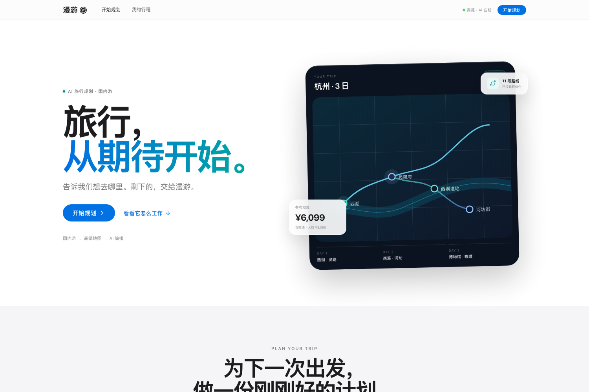
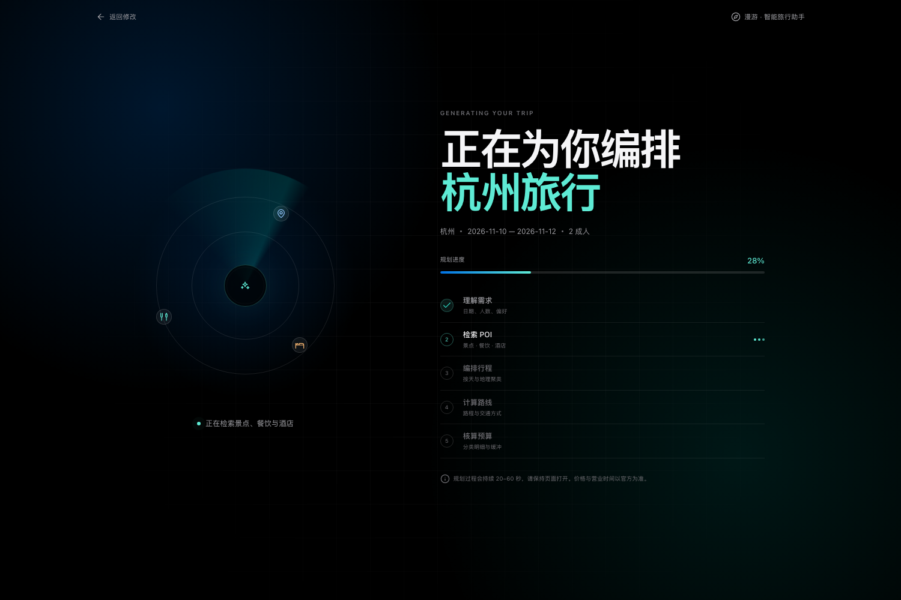
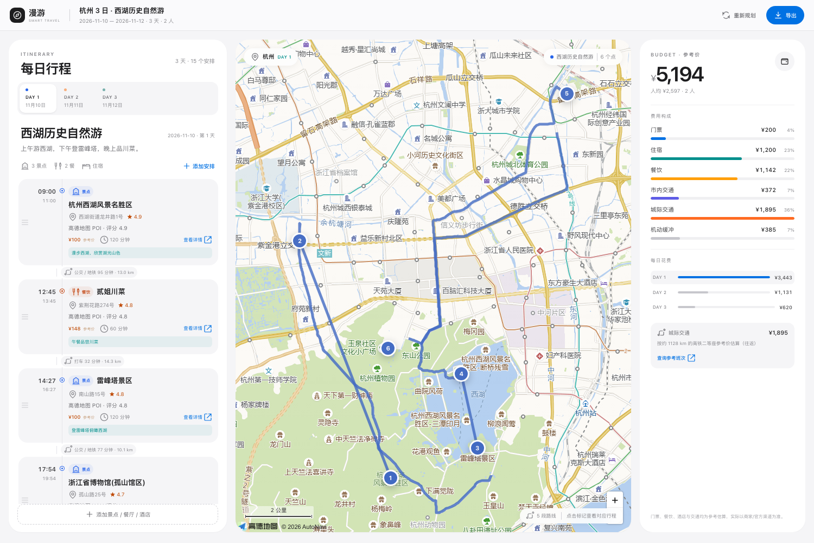

# 漫游 · 智能旅行助手

面向国内游的 AI 行程规划 Web 应用。输入目的地、日期、人数与偏好，自动生成包含景点、餐饮、酒店和交通的按天行程，并提供地图可视化、预算明细、行程编辑与 PDF/长图导出。

当前版本是 **单城市、匿名会话的 MVP**，前后端分离，默认使用成都内置样例即可演示；配置高德和大模型 Key 后，可规划任意国内城市并启用 AI 编排。

## 界面预览

> 以下为当前界面截图，使用真实高德地图与 AI 规划。

| 首页 / 需求表单 | 规划进度 |
|---|---|
|  |  |



*杭州工作台：真实高德底图、AI 编排、分日路线与预算明细。*

## 已实现功能

- **智能行程规划**
  - 表单采集目的地、出发地、日期、人数、预算、风景/美食偏好、节奏、酒店档位
  - 高德 POI 检索（景点/餐饮/酒店）+ 候选去重 + 规则编排
  - 配置大模型后，由 LLM 按候选 ID 编排，服务端校验并补齐
  - SSE 实时推送规划阶段与进度，断线后可从任务状态恢复
- **地图可视化**
  - 高德 JS API 2.0 地图、分日 Marker、路线 Polyline、视野自适应
  - 未配置 JS Key 时自动降级为 SVG 路线示意图
  - 点击地图标记与时间轴卡片双向联动
- **预算计算**
  - 门票、住宿、餐饮、市内交通、城际交通、机动缓冲分类汇总
  - 人均、每日花费、超支提示
  - 酒店按间/晚去重，所有金额使用整数分计算
  - 参考价标识与查询链接
- **行程编辑**
  - 添加景点/餐厅/酒店（高德搜索或内置数据）
  - 删除、拖拽排序、上移/下移、锁定
  - 每次编辑自动重算受影响路线与预算，地图实时更新
- **导出分享**
  - 服务端 Playwright/Chrome 渲染 A4 PDF 或长图 PNG
  - 含封面、行程总览、地图示意、每日时间轴、预算明细
  - Chrome 不可用时自动降级为可打印 HTML

## 技术栈

| 层 | 技术 |
|---|---|
| 前端 | Vue 3 + TypeScript + Vite + Pinia + Vue Router |
| 地图 | 高德 JS API 2.0 + 高德 Web 服务 API |
| 后端 | Python 3.9+ + FastAPI + Pydantic v2 + SQLAlchemy 2 async |
| 数据 | SQLite（默认，零配置）/ 可换 PostgreSQL；本地文件存储导出物 |
| Agent | 自研规划状态机 + OpenAI 兼容 LLM（DeepSeek / Qwen 等） |
| 导出 | Jinja2 + Chrome Headless（PDF / PNG） |
| 测试 | pytest + vue-tsc + Vite build |

## 快速开始

### 1. 环境要求

- Python 3.9+
- Node.js 20+（推荐 pnpm 9/10）
- Google Chrome / Chromium（导出 PDF/PNG 需要，可选）
- 高德 Key（可选，不配置也能用成都样例演示）
- 大模型 Key（可选，不配置则使用规则引擎）

### 2. 安装依赖

```bash
cd travel-assistant

# 后端
python3 -m venv .venv
source .venv/bin/activate
pip install -r backend/requirements.txt

# 前端
cd frontend
pnpm install
cd ..
```

> 如果 pnpm 提示 `Ignored build scripts: esbuild`，可执行 `pnpm approve-builds` 并允许 esbuild；不处理通常也能构建。

### 3. 配置环境变量

```bash
cp .env.example .env
```

编辑项目根目录的 `.env`：

| 变量 | 必填 | 说明 |
|---|---|---|
| `AMAP_KEY` | 规划任意城市时必填 | 高德 **Web 服务** Key（服务端调用 POI/路线/静态图） |
| `AMAP_WEB_KEY` | 可选 | `AMAP_KEY` 的别名 |
| `VITE_AMAP_KEY` | 地图可视化时必填 | 高德 **Web 端（JS API）** Key |
| `VITE_AMAP_SECURITY_CODE` | 地图可视化时必填 | 高德 JS API 安全密钥 |
| `LLM_API_KEY` | 可选 | 大模型 API Key；不填则只走规则引擎 |
| `LLM_BASE_URL` | 可选 | 默认 `https://api.deepseek.com/v1` |
| `LLM_MODEL` | 可选 | 默认 `deepseek-chat` |
| `CHROME_BIN` | 可选 | 自定义 Chrome 路径；不填自动探测 |
| `DATABASE_URL` | 可选 | 默认 SQLite；可换 PostgreSQL |

注意：

- 高德 **Web 服务 Key** 和 **JS API Key** 通常是两个 Key，权限不同，请分别申请。
- `VITE_*` 变量会在前端构建时写入产物。修改后需要重新执行 `pnpm build`（开发模式重启 `pnpm dev` 即可）。
- `.env` 已被 `.gitignore` 忽略，不会提交。

### 4. 启动

#### 方式 A：生产构建 + 单端口（推荐演示）

```bash
cd frontend
pnpm build
cd ../backend
../.venv/bin/uvicorn app.main:app --host 127.0.0.1 --port 8000
```

打开 <http://127.0.0.1:8000>。FastAPI 同时提供 API 和前端静态文件。

#### 方式 B：前后端分离开发

终端 1：

```bash
cd backend
../.venv/bin/uvicorn app.main:app --reload --host 127.0.0.1 --port 8000
```

终端 2：

```bash
cd frontend
pnpm dev
```

打开 <http://127.0.0.1:5173>。Vite 会将 `/api` 代理到 8000。

API 文档：<http://127.0.0.1:8000/docs>

## 页面打不开 / 重启服务

如果访问 <http://127.0.0.1:8000> 出现 `ERR_CONNECTION_REFUSED`，先确认服务是否在运行：

```bash
cd travel-assistant
./start.sh   # 启动后端；已在运行时会直接打开页面
./stop.sh    # 停止后端
```

也可以直接双击项目根目录的 **`start.command`**，会自动启动服务并打开浏览器。

脚本默认绑定 `0.0.0.0`，因此同一局域网内也可以用本机 IP 访问：

```bash
ipconfig getifaddr en0
# 然后打开 http://<上面的 IP>:8000
```

只想本机访问时：

```bash
HOST=127.0.0.1 ./start.sh
```

日志在 `backend/data/server.log`。手动启动命令：

```bash
cd backend
../.venv/bin/uvicorn app.main:app --host 0.0.0.0 --port 8000
```

> 该服务不会随 macOS 开机自启；电脑重启、终端关闭或会话结束后，需要重新执行 `./start.sh`。
> 如果页面能打开但地图降级为示意图，请把当前访问域名/IP 加入高德 JS API Key 的域名白名单。

## 无 Key 演示模式

不配置任何 Key 时：

- 仅内置**成都**的样例 POI，规划结果使用规则引擎
- 地图展示 SVG 路线示意图（真实地图需要 `VITE_AMAP_KEY`）
- 导出使用本机 Chrome；找不到 Chrome 时下载可打印 HTML
- 其他城市会提示配置 `AMAP_WEB_KEY`

内置样例覆盖武侯祠、锦里、宽窄巷子、熊猫基地、杜甫草堂、四川博物院、金沙遗址、春熙路酒店、川菜/火锅/小吃等。

## 项目结构

```text
travel-assistant/
├── .env.example
├── backend/
│   ├── app/
│   │   ├── api/routes.py          # REST + SSE + 导出下载
│   │   ├── domain/
│   │   │   ├── budget.py          # 预算引擎
│   │   │   ├── itinerary.py       # 条目/路线/时间重排
│   │   │   ├── models.py          # Candidate
│   │   │   ├── planner.py         # 规则编排 + LLM 结果补全
│   │   │   └── seed.py            # 成都演示 POI
│   │   ├── services/
│   │   │   ├── agent.py           # 规划流水线
│   │   │   ├── amap.py            # 高德 Web 服务适配
│   │   │   ├── exporter.py        # Chrome PDF/PNG
│   │   │   ├── llm.py             # OpenAI 兼容调用
│   │   │   ├── run_manager.py     # 任务状态 + SSE 事件流
│   │   │   └── trip_service.py    # 行程组装/重算
│   │   ├── templates/export.html  # 导出模板
│   │   ├── config.py
│   │   ├── db.py
│   │   ├── models.py
│   │   └── main.py
│   ├── requirements.txt
│   ├── tests/
│   └── data/                      # 运行时生成：SQLite、导出文件（已忽略）
├── frontend/
│   ├── src/
│   │   ├── views/                 # 首页 / 规划中 / 工作台 / 我的行程
│   │   ├── components/            # 地图、预算、搜索弹窗、导出弹窗
│   │   ├── api.ts                 # REST + SSE 客户端
│   │   ├── stores.ts              # Pinia
│   │   └── types.ts
│   └── dist/                      # pnpm build 产物（已忽略）
├── docs/                          # 可放项目补充文档
└── README.md
```

## API 概览

统一前缀 `/api/v1`。

| 方法 | 路径 | 说明 |
|---|---|---|
| `GET` | `/session` | 创建/读取匿名会话 Cookie |
| `POST` | `/plan-runs` | 创建规划任务 |
| `GET` | `/plan-runs/{id}/events` | SSE 规划进度 |
| `GET` | `/plan-runs/{id}` | 查询任务状态 |
| `GET` | `/trips` | 当前会话的行程列表 |
| `GET` | `/trips/{id}` | 行程详情 |
| `POST` | `/trips/{id}/items` | 添加条目 |
| `PATCH` | `/trips/{id}/items/{itemId}` | 修改条目 |
| `DELETE` | `/trips/{id}/items/{itemId}` | 删除条目 |
| `PUT` | `/trips/{id}/days/{dayIndex}/order` | 保存排序 |
| `GET` | `/poi/search` | POI 搜索 |
| `POST` | `/trips/{id}/exports` | 创建 PDF/PNG 导出 |
| `GET` | `/exports/{id}` | 查询导出状态 |
| `GET` | `/exports/{id}/download` | 下载导出文件 |

匿名会话通过 `ta_sid` HttpOnly Cookie 识别，行程数据按会话隔离。

## 数据与重置

默认数据库：`backend/data/app.db`，导出文件：`backend/data/exports/`。

清空演示数据：

```bash
rm -rf backend/data
```

下次启动会自动重建数据库。生产环境建议换 PostgreSQL 并接入对象存储，参见架构文档。

## 测试与检查

```bash
# 后端
cd backend
../.venv/bin/pytest -q

# 前端类型与构建
cd ../frontend
pnpm typecheck
pnpm build
```

## 导出说明

- PDF：A4、封面、总览/地图、预算、每日时间轴，每天强制分页。
- PNG：长图，包含封面与全部日程；按天数动态计算高度，避免截断。
- 服务端自动探测 Chrome：
  - macOS：`/Applications/Google Chrome.app/Contents/MacOS/Google Chrome`
  - Linux：`google-chrome` / `chromium` / `chromium-browser`
  - 也可通过 `CHROME_BIN` 指定。
- 若 Chrome 不可用，会生成可打印 HTML，浏览器打开后仍可“另存为 PDF”。
- 高德静态地图需要 Web 服务 Key；不可用时导出模板会使用内置 SVG 路线示意图。

## 当前边界

- 单城市，2–7 天，1–6 人；多城市联游未实现
- 不做真实库存、下单、支付、退改签
- 门票/酒店/交通价格为参考估算；如需实时价格需接 OTA/12306 等合规数据源
- 匿名会话保存在浏览器 Cookie；换浏览器/清 Cookie 后无法找回
- 规划任务为单进程内存状态，服务重启后运行中的任务不会自动恢复
- LLM 只允许从候选 POI 中选点排程，不生成坐标/价格；未配置 Key 时自动回退规则引擎

## 架构文档

更完整的分层、Agent 状态机、数据模型、接口与部署设计见上级目录：

- [系统架构设计.md](../docs/architecture.md)
- [architecture.html](../docs/architecture.html)

## 合规提示

- 地图数据版权归高德所有，请遵守高德开放平台授权与配额要求
- 行程由 AI/规则引擎生成，页面与导出物均标注“参考价/AIGC”
- 门票、营业时间、交通班次请以官方渠道为准
- 生产环境请启用 HTTPS、设置 `Secure` Cookie，并接入限流与日志脱敏
